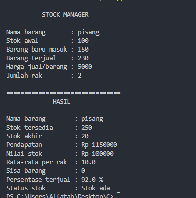

# Stock Manager
Project Ujian Tengah Semester (UTS) mata pelajaran Pemrograman Dasar /
Koding & Kecerdasan Artifisial kelas X PPLG. Aplikasi ini dibuat dalam
dua versi bahasa pemrograman, yaitu **C** dan **Python**.
## Identitas Siswa
* **Nama Lengkap:** Chairul Azam Yalestiano
* **Kelas:** X PPLG
* **No. Absen:** 11
## Deskripsi Aplikasi
Stock Manager adalah aplikasi sederhana untuk mengelola dan menghitung stok barang. Aplikasi ini digunakan untuk mengetahui jumlah stok tersedia, stok akhir, pendapatan dari barang terjual, nilai stok, serta status stok.
Fitur yang tersedia:
-Menghitung stok tersedia dan stok akhir.
-Menghitung pendapatan dan nilai stok.
-Menghitung rata-rata barang per rak.
-Menghitung sisa barang dengan modulus.
-Menghitung persentase barang terjual.

Menampilkan status stok: stok ada, menipis, atau habis
## Daftar File
* `managestok.c` : Kode program utama menggunakan bahasa C.
* `manage-stock.py` : Kode program utama menggunakan bahasa Python.
* `output-program.png` : Screenshot hasil menjalankan program aplikasi.
## Screenshot Output Program

